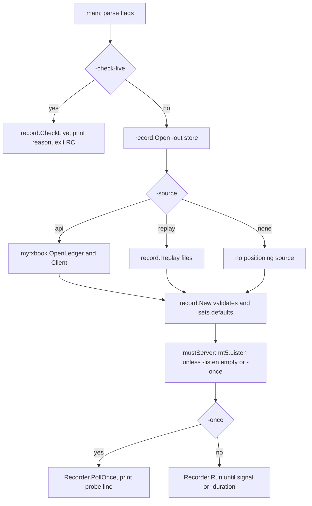
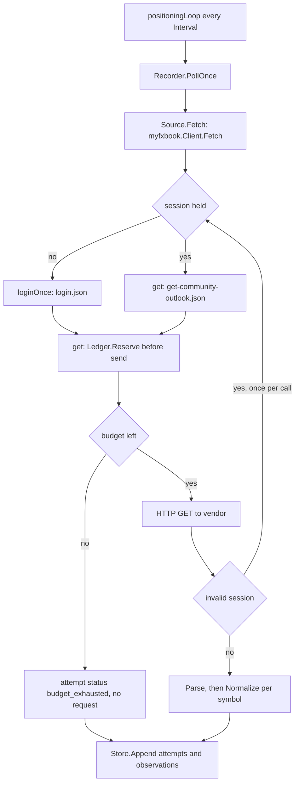
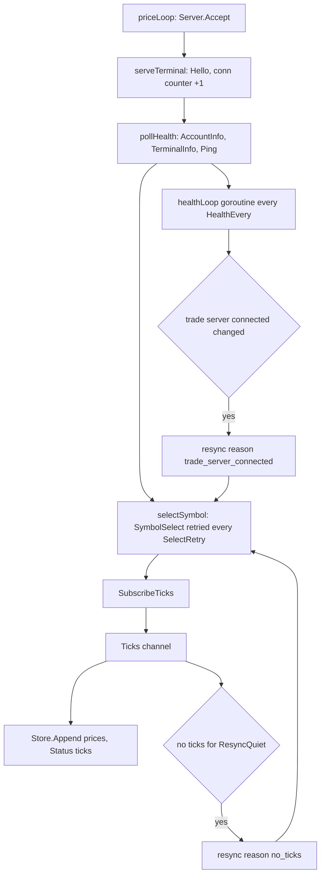
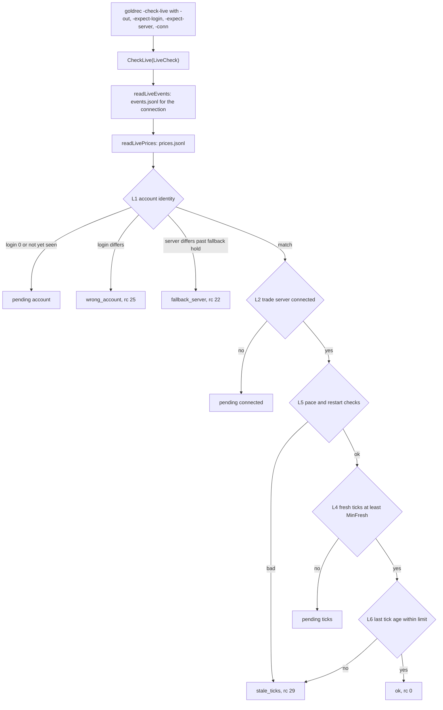
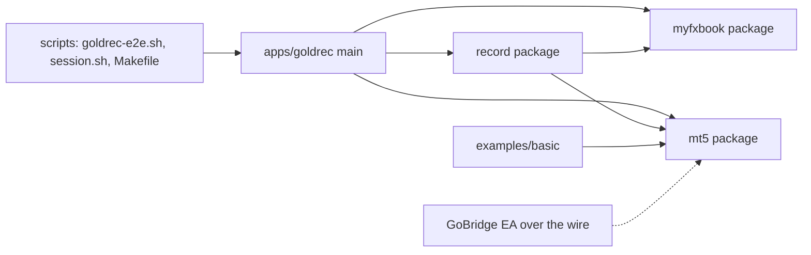

# apps

## Purpose

The Go recorder in `apps/goldrec` polls Myfxbook XAUUSD positioning and records broker ticks from a GoBridge EA side by side, as append-only JSON Lines, with no order code path.
Health poll, symbol retry and resync live in `apps/goldrec/record/recorder.go`; `-check-live` verdicts live in `apps/goldrec/record/livecheck.go`.
The Myfxbook adapter (`apps/goldrec/myfxbook/`) spends a 24h request budget through `ledger.go` before each vendor send.
`examples/basic` is a separate demo that uses the `mt5` package directly.

## Flows

Call flow: startup and mode dispatch

Request lifecycle: one positioning poll

Data flow: terminal connection and ticks

Call flow: -check-live judgement

Module dependencies

## Key symbols

| Symbol | Kind | Path | Grep anchor | Role |
|---|---|---|---|---|
| main flags | Function | apps/goldrec/main.go | `flag.Bool("check-live"` | Flag parsing, -check-live exit path, source dispatch |
| record.New | Function | apps/goldrec/record/recorder.go | `func New(cfg Config)` | Validates Config and applies defaults |
| Config.SelectRetry | Field | apps/goldrec/record/recorder.go | `SelectRetry time.Duration` | Retry period while the terminal refuses the broker symbol |
| Recorder | Struct | apps/goldrec/record/recorder.go | `type Recorder struct {` | Run state, per-connection terminal state, status snapshot |
| Recorder.Run | Method | apps/goldrec/record/recorder.go | `func (r *Recorder) Run(ctx` | Starts positioning, price and housekeeping goroutines; stops on store failure |
| Recorder.PollOnce | Method | apps/goldrec/record/recorder.go | `func (r *Recorder) PollOnce(ctx` | One vendor round: attempts, observations, quarantine |
| Recorder.priceLoop | Method | apps/goldrec/record/recorder.go | `func (r *Recorder) priceLoop(ctx` | Accepts EA connections and serves each one in turn |
| Recorder.serveTerminal | Method | apps/goldrec/record/recorder.go | `func (r *Recorder) serveTerminal(` | Per-connection flow: Hello, first poll, health loop, symbol select, tick append |
| Recorder.healthLoop | Method | apps/goldrec/record/recorder.go | `func (r *Recorder) healthLoop(` | Ticker that calls pollHealth every HealthEvery until disconnect |
| Recorder.pollHealth | Method | apps/goldrec/record/recorder.go | `func (r *Recorder) pollHealth(` | AccountInfo, TerminalInfo and Ping; writes events on change only |
| Recorder.selectSymbol | Method | apps/goldrec/record/recorder.go | `func (r *Recorder) selectSymbol(` | Retries SymbolSelect for the connection's life, logs changed candidates |
| Recorder.resync | Method | apps/goldrec/record/recorder.go | `func (r *Recorder) resync(` | Re-selects and re-subscribes, records select error and candidates |
| CheckLive | Function | apps/goldrec/record/livecheck.go | `func CheckLive(c LiveCheck)` | Read-only verdict for one connection: reason, RC, Waiting |
| LiveCheck | Struct | apps/goldrec/record/livecheck.go | `type LiveCheck struct {` | Inputs: Dir, ExpectLogin, ExpectServer, MinFresh, Conn |
| Client.Fetch | Method | apps/goldrec/myfxbook/client.go | `func (c *Client) Fetch(ctx` | Login if needed, outlook fetch, one re-login per call on invalid session |
| Ledger.Reserve | Method | apps/goldrec/myfxbook/ledger.go | `func (l *Ledger) Reserve(` | Records a request before send, or returns ErrBudget |
| Normalize | Function | apps/goldrec/myfxbook/parse.go | `func Normalize(` | Derives values per symbol; sets Quarantined when a needed field is unreadable |
| Listen | Function | mt5/server.go | `func Listen(` | Opens the listener the GoBridge EA dials into |

## Contract

| Endpoint or message | Server | Client | Payload |
|---|---|---|---|
| Myfxbook login.json | Myfxbook vendor API | myfxbook.Client.loginOnce | Query: email, password (from MYFXBOOK_EMAIL, MYFXBOOK_PASSWORD; never recorded) |
| Myfxbook get-community-outlook.json | Myfxbook vendor API | myfxbook.Client.Fetch via get | Query: session |
| Myfxbook logout.json | Myfxbook vendor API | myfxbook.Client.Logout via get | Query: session |
| EA Hello (sent on connect) | apps/goldrec (mt5.Listen) | GoBridge EA | protocol.Hello: Login, Server, Company, Build, EAVersion |
| Terminal Ping | GoBridge EA | record.pollHealth | No arguments; reply is the trade server clock in seconds |
| Terminal TerminalInfo | GoBridge EA | record.pollHealth | No arguments; reply carries Connected and Build |
| Terminal AccountInfo | GoBridge EA | record.pollHealth | No arguments; recorder keeps only login, server, company, trade_allowed |
| Terminal SymbolSelect | GoBridge EA | Recorder.selectSymbol, Recorder.resync | symbol string, enable bool |
| Terminal SymbolsGet | GoBridge EA | Recorder.selectSymbol, Recorder.resync | group pattern string, selectedOnly bool |
| Terminal SubscribeTicks | GoBridge EA | Recorder.serveTerminal | symbol string; ticks then arrive on the Ticks channel |

## Dependencies

| Direction | Area | Through |
|---|---|---|
| apps -> client | client | `mt5` package imported by apps/goldrec and examples/basic: Listen, Terminal methods, Tick, ServerTimeMsc |
| apps -> ea | ea | `mt5.Listen` accepts the GoBridge EA connection; the EA token comes from GOBRIDGE_TOKEN |
| apps -> protocol | protocol | Terminal.Hello() returns protocol.Hello; apps reads its fields without importing protocol |
| examples -> client | client | examples/basic imports `mt5` for Listen and Config (part of the apps area) |
| tooling -> apps | tooling | scripts/goldrec-e2e.sh, scripts/session.sh and the Makefile run apps/goldrec |
