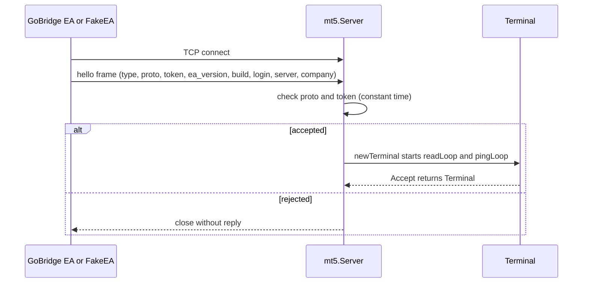
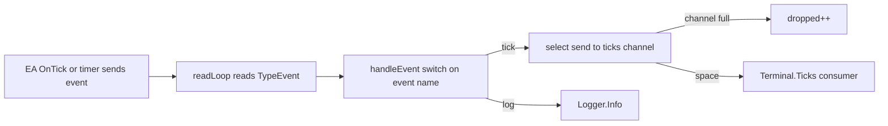
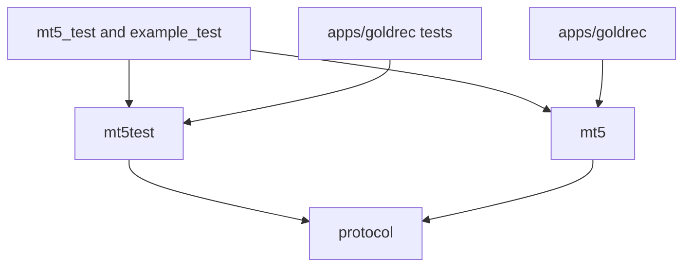

# client

## Purpose
- Go side of the MT5 bridge: the `mt5` package and its test double `mt5/mt5test`.
- `Server` accepts TCP connections from the EA and runs the hello handshake.
- Each accepted connection is a `Terminal`: `Call` sends flat JSON requests, and typed wrappers in `api.go` sit on top of it.
- Tick events arrive on a channel from `Terminal.Ticks()`.
- `mt5test.FakeEA` replaces the EA in tests.

## Flows

```mermaid
flowchart LR
    A["Caller: Terminal.OrderSend or Call"] --> B["Call: wrap context deadline"]
    B --> C["register id in pending map"]
    C --> D["json.Marshal protocol.Request"]
    D --> E["WriteFrame under writeMu"]
    E --> F["EA Dispatch and reply"]
    F --> G["readLoop reads TypeResponse"]
    G --> H["pending[id] channel"]
    H --> I["Call returns result or protocol.Error"]
```

## Key symbols

| Symbol | Kind | Path | Grep anchor | Role |
|---|---|---|---|---|
| Listen | func | mt5/server.go | `func Listen(addr string` | Opens a plain TCP listener and wraps NewServer |
| NewServer | func | mt5/server.go | `func NewServer(ln net.Listener` | Starts accept loop on an existing listener; requires Token unless AllowNoToken |
| AllowNoToken | field | mt5/server.go | `AllowNoToken bool` | Config switch that permits an empty token |
| Server | type | mt5/server.go | `type Server struct` | Holds listener and the accepted terminals channel |
| Server.Accept | method | mt5/server.go | `func (s *Server) Accept(ctx context.Context` | Waits for the next handshaked Terminal |
| Server.handshake | method | mt5/server.go | `func (s *Server) handshake(c net.Conn` | Checks hello type, proto and token |
| Terminal | type | mt5/server.go | `type Terminal struct` | One EA connection with pending map and tick channel |
| Terminal.Call | method | mt5/server.go | `func (t *Terminal) Call(ctx context.Context, method string` | Generic request/response over one frame each way |
| Terminal.readLoop | method | mt5/server.go | `func (t *Terminal) readLoop()` | Routes responses to pending channels and events to handleEvent |
| Terminal.handleEvent | method | mt5/server.go | `func (t *Terminal) handleEvent(` | Pushes tick events to channel; counts drops when full |
| Terminal.Ticks | method | mt5/server.go | `func (t *Terminal) Ticks(` | Returns the receive-only tick channel |
| Terminal.OrderSend | method | mt5/api.go | `func (t *Terminal) OrderSend(` | Typed order_send wrapper |
| Terminal.SubscribeTicks | method | mt5/api.go | `func (t *Terminal) SubscribeTicks(` | Typed subscribe_ticks wrapper |
| MethodOrderSend | const | mt5/api.go | `MethodOrderSend ` | Wire method name for order_send |
| TerminalInfo | type | mt5/types.go | `type TerminalInfo struct` | Decoded terminal_info result |
| Handler | type | mt5/mt5test/fakeea.go | `type Handler func` | Test handler signature for one method |
| mt5test.New | func | mt5/mt5test/fakeea.go | `func New(token string)` | Builds a FakeEA with default hello and ping handler |
| FakeEA.Dial | method | mt5/mt5test/fakeea.go | `func (f *FakeEA) Dial(addr string)` | Connects to a Server, sends hello, serves requests |
| FakeEA.SendEvent | method | mt5/mt5test/fakeea.go | `func (f *FakeEA) SendEvent(` | Emits an unsolicited event to the Go side |

## Contract

| Endpoint or message | Server | Client | Payload |
|---|---|---|---|
| hello (first frame) | Server.handshake | GoBridge EA; mt5test.FakeEA.Dial | `{"type":"hello","proto","token","ea_version","build","login","server","company"}` |
| request (any method) | Terminal.Call writes it | GoBridge EA Dispatch; FakeEA handlers | flat `{"id","method", scalar params}` |
| response | Terminal.readLoop matches id | GoBridge EA; FakeEA | `{"type":"res","id","ok","result"}` or `{"ok":false,"error":{code,message}}` |
| event tick | Terminal.handleEvent | GoBridge EA timer and OnTick; FakeEA.SendEvent | `{"type":"event","event":"tick","data":{symbol,time,bid,ask,last,volume,time_msc,flags,volume_real}}` |
| order_send | Terminal.OrderSend | GoBridge EA | flat MqlTradeRequest fields; result MqlTradeResult |
| subscribe_ticks | Terminal.SubscribeTicks | GoBridge EA | `symbol`; result `true` |

## Dependencies

| Direction | Area | Through |
|---|---|---|
| out | protocol | import of `github.com/condrove10/gomql5/protocol` (ReadFrame, WriteFrame, Hello, Request, Envelope, Error) |
| out | ea | wire contract in `docs/protocol.md`, EA side in `mql5/Experts/GoBridge/GoBridge.mq5` (`Dispatch`) |
| in | apps | `apps/goldrec/main.go` calls `mt5.Listen`; `apps/goldrec/record` tests use `mt5test.New` |
| in | tooling | `mt5/constants_gen.go` is generated from the MetaTrader5 Python package via `tools/genconst/genconst.py`; `go test` runs through `make session` |
