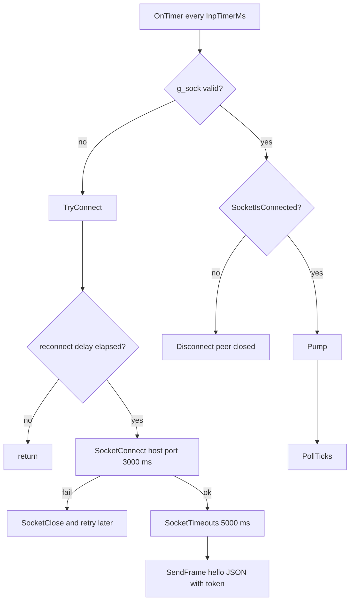
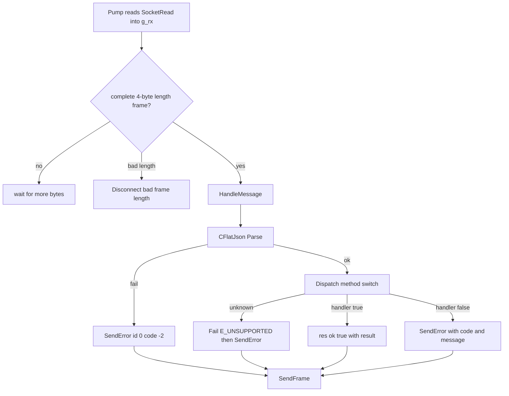
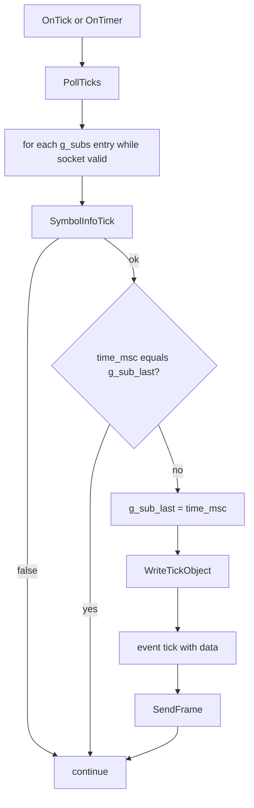
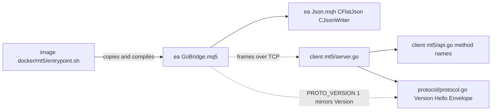

# ea

## Purpose
- GoBridge.mq5 is the MT5-side Expert Advisor. It dials OUT to the Go `mt5.Server` (MQL5 cannot listen), sends a `hello` with the shared token, then answers requests.
- Wire format: 4-byte big-endian length plus UTF-8 JSON. Helper parser and writer come from `mql5/Include/GoBridge/Json.mqh`.
- Work is driven by a millisecond timer (`InpTimerMs`, default 10 ms). `OnTick` also polls ticks while connected.
- Subscribed symbols are tracked in `g_subs`. A `tick` event is pushed when `time_msc` changes.
- Compile happens only in MetaEditor, via the Docker entrypoint (`docker/mt5/entrypoint.sh`). MQL5 changes are unverified until `scripts/e2e.sh` passes.

## Flows

Connection and timer loop:

Request lifecycle (inbound frame to reply):

Tick polling (event push):

Module dependency:

## Key symbols

| Symbol | Kind | Path | Grep anchor | Role |
|---|---|---|---|---|
| OnInit | Function | mql5/Experts/GoBridge/GoBridge.mq5 | `int OnInit()` | Validates token, sets millisecond timer |
| OnTimer | Function | mql5/Experts/GoBridge/GoBridge.mq5 | `void OnTimer()` | Connect when no socket, else check liveness, Pump, PollTicks |
| OnTick | Function | mql5/Experts/GoBridge/GoBridge.mq5 | `void OnTick()` | Calls PollTicks while connected |
| TryConnect | Function | mql5/Experts/GoBridge/GoBridge.mq5 | `void TryConnect()` | Opens socket to InpHost:InpPort and sends hello |
| Disconnect | Function | mql5/Experts/GoBridge/GoBridge.mq5 | `void Disconnect(const string why)` | Closes socket, clears receive buffer and subscriptions |
| SendFrame | Function | mql5/Experts/GoBridge/GoBridge.mq5 | `bool SendFrame(const string json)` | Writes length-prefixed frame, loops on partial sends |
| Pump | Function | mql5/Experts/GoBridge/GoBridge.mq5 | `bool Pump()` | Reads socket, reassembles frames, calls HandleMessage |
| HandleMessage | Function | mql5/Experts/GoBridge/GoBridge.mq5 | `void HandleMessage(const string msg)` | Parses request, runs Dispatch, sends res or error |
| Dispatch | Function | mql5/Experts/GoBridge/GoBridge.mq5 | `bool Dispatch(const string m` | Method-name switch to M_* handlers |
| SendError | Function | mql5/Experts/GoBridge/GoBridge.mq5 | `void SendError(const long id` | Sends res with ok false and error object |
| M_Subscribe | Function | mql5/Experts/GoBridge/GoBridge.mq5 | `bool M_Subscribe(CFlatJson &p` | SymbolSelect then adds symbol to g_subs |
| PollTicks | Function | mql5/Experts/GoBridge/GoBridge.mq5 | `void PollTicks()` | Emits tick event when time_msc changes |
| CFlatJson | Class | mql5/Include/GoBridge/Json.mqh | `class CFlatJson` | Parser for flat (scalar-only) request objects |
| PROTO_VERSION | Macro | mql5/Experts/GoBridge/GoBridge.mq5 | `#define PROTO_VERSION 1` | Protocol version sent in hello |
| handshake | Method | mt5/server.go | `func (s *Server) handshake(c net.Conn)` | Go side: reads hello, checks type, proto and token |
| pingLoop | Method | mt5/server.go | `func (t *Terminal) pingLoop()` | Go side: periodic `ping` Call as heartbeat |
| handleEvent | Method | mt5/server.go | `func (t *Terminal) handleEvent(` | Go side: routes `tick` events to channel |

## Contract

| Endpoint or message | Server | Client | Payload |
|---|---|---|---|
| hello (EA to Go, first frame) | handshake in mt5/server.go | TryConnect in GoBridge.mq5 | type, proto, token, ea_version, build, login, server, company. Token is cleared server-side after check |
| res (ok) | Terminal.Call expects the id | HandleMessage sends it | type res, id, ok true, result (body or null) |
| res (error) | Terminal.Call expects the id | SendError sends it | type res, id, ok false, error with code and message |
| ping (request) | pingLoop calls Call with ping | Dispatch with m=="ping" | No params; result has time (TimeTradeServer) |
| subscribe_ticks (request) | MethodSubscribeTicks in mt5/api.go | M_Subscribe | params symbol; result true |
| unsubscribe_ticks (request) | MethodUnsubscribeTicks in mt5/api.go | M_Unsubscribe | params symbol (empty clears all); result true |
| event tick (EA to Go) | handleEvent case tick | PollTicks | type event, event tick, data is the tick object from WriteTickObject |
| event log (EA to Go) | handleEvent case log | not emitted (no match in GoBridge.mq5) | Go handles it; EA side has no emitter |

Frame limits: EA `MAX_FRAME` is 33554432 bytes. The Go `MaxFrame` config is a separate setting.

## Dependencies

| Direction | Area | Through |
|---|---|---|
| ea depends on protocol | protocol | Frame format, type names (hello, res, event), PROTO_VERSION mirrors protocol/protocol.go `Version` |
| ea depends on client | client | Method names (ping, subscribe_ticks, unsubscribe_ticks, copy_ticks_range and others) defined in mt5/api.go; server handshake in mt5/server.go |
| client depends on ea | client | Same TCP frames; Go Terminal.Call and handleEvent consume EA replies and tick events |
| ea depends on image | image | docker/mt5/entrypoint.sh copies mql5 into the MT5 tree and compiles GoBridge.mq5 under Wine |
| ea depends on ea (include) | ea | `#include <GoBridge/Json.mqh>` in GoBridge.mq5 |
