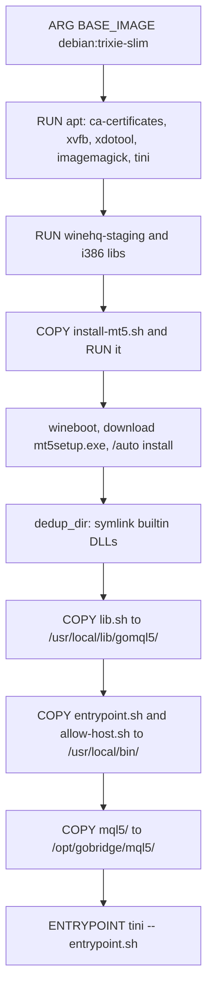
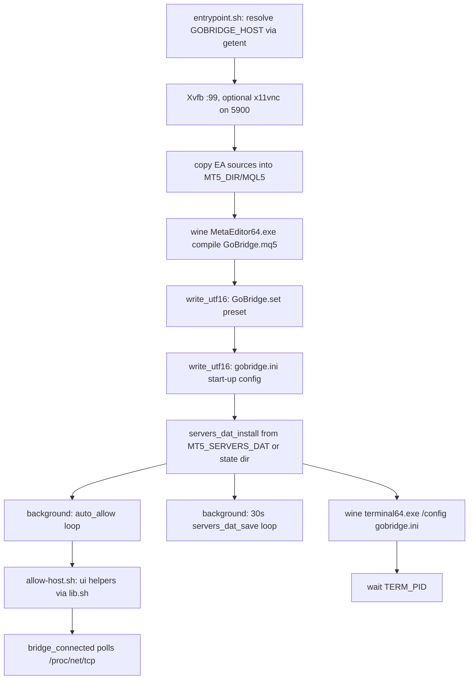
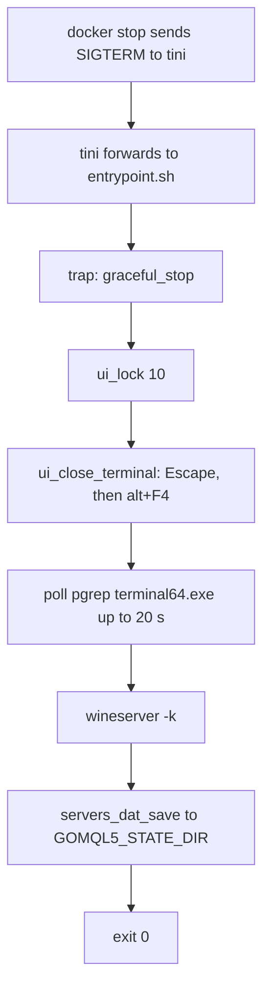
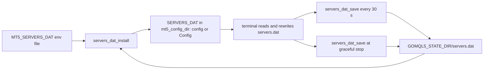

# image

## Purpose
- Builds the MetaTrader 5 container image (Wine staging on Debian trixie, headless Xvfb) with the GoBridge EA source copied in and compiled at start-up.
- `entrypoint.sh` starts the terminal, installs the EA and its preset, writes the start-up config, and keeps `servers.dat` in sync with a state directory.
- `lib.sh` holds the UI coordinates, the UI lock and the `servers.dat` helpers; `allow-host.sh` drives the Options dialog to allow the Go bridge host.
- `docker-compose.yml` wires the `mt5` service (volume, shm, VNC on 127.0.0.1) to the `app` service.
- No Go source lives in this area, so gopls has no symbols to report here.

## Flows

Build flow (Dockerfile stages):

Start-up call flow (entrypoint.sh):

Stop lifecycle (request lifecycle of SIGTERM):

servers.dat data flow:

## Key symbols

| Symbol | Kind | Path | Grep anchor | Role |
|---|---|---|---|---|
| entrypoint.sh | script | docker/mt5/entrypoint.sh | `wait "$TERM_PID"` | Start-up sequence, EA install, config writes, terminal launch |
| write_utf16 | shell function | docker/mt5/entrypoint.sh | `write_utf16() {` | Writes UTF-16LE with BOM and CRLF (MT5 ini and set format) |
| auto_allow | shell function | docker/mt5/entrypoint.sh | `auto_allow() {` | Retries allow-host.sh until bridge_connected sees the EA |
| graceful_stop | shell function | docker/mt5/entrypoint.sh | `graceful_stop() {` | SIGTERM handler: close the terminal cleanly, save servers.dat |
| dedup_dir | shell function | docker/mt5/install-mt5.sh | `dedup_dir() {` | Replaces identical Wine builtin DLLs with symlinks at build time |
| HOST usage guard | shell statement | docker/mt5/allow-host.sh | `HOST="${1:?usage: allow-host.sh <host>}"` | Requires the host argument for allow-host.sh |
| ui_lock | shell function | docker/mt5/lib.sh | `ui_lock() {` | Takes the shared UI lock (fd 9, flock) |
| ui_wait_main | shell function | docker/mt5/lib.sh | `ui_wait_main() {` | Waits for the terminal64 main window |
| ui_options_add_url | shell function | docker/mt5/lib.sh | `ui_options_add_url() {` | Types an entry into the Experts allowed-URL list |
| ui_close_terminal | shell function | docker/mt5/lib.sh | `ui_close_terminal() {` | Closes the main window so settings are saved |
| bridge_connected | shell function | docker/mt5/lib.sh | `awk -v p=":$hex"` | True when an ESTABLISHED TCP connection to the bridge port exists |
| mt5_config_dir | shell function | docker/mt5/lib.sh | `if [ -d "$d/config" ]` | Chooses the config folder the terminal actually uses |
| servers_dat_install | shell function | docker/mt5/lib.sh | `cp "$src" "$tmp" && mv -f "$tmp" "$dest"` | Atomically installs a servers.dat |
| servers_dat_save | shell function | docker/mt5/lib.sh | `mv -f "$tmp" "$dir/servers.dat"` | Copies the terminal's servers.dat to the state dir when it changed |
| UI_OPTIONS_OK | coordinate constant | docker/mt5/lib.sh | `UI_OPTIONS_OK="759 765"` | Options dialog OK click position (1280x1024 screen) |
| Expert preset line | config key | docker/mt5/entrypoint.sh | `Expert=GoBridge\\GoBridge` | Auto-attached EA in gobridge.ini [StartUp] |
| mt5 service | compose service | docker-compose.yml | `shm_size: 512m` | Builds and runs the terminal container with the mt5data volume |
| BASE_IMAGE | build arg | docker/mt5/Dockerfile | `FROM ${BASE_IMAGE}` | Base image selection (overridable for Docker Hub rate limits) |

## Dependencies

| Direction | Area | Through |
|---|---|---|
| image -> ea | ea | Dockerfile `COPY mql5/` to /opt/gobridge/mql5, then MetaEditor compile in entrypoint.sh |
| ea -> image | ea | EA connects out to GOBRIDGE_HOST:GOBRIDGE_PORT; detected by bridge_connected in lib.sh |
| image -> protocol | protocol | entrypoint.sh writes InpHost, InpPort and InpToken into MQL5/Presets/GoBridge.set |
| image -> client | client | GOBRIDGE_TOKEN is the shared secret equal to mt5.Config.Token (comment in entrypoint.sh) |
| image -> apps | apps | docker-compose.yml `app` service built from examples/basic/Dockerfile; mt5 `depends_on: app`; host `app` resolved by getent |
| tooling -> image | tooling | scripts/mt5ctl.sh runs `source /usr/local/lib/gomql5/lib.sh` via docker exec; scripts/goldrec-e2e.sh and scripts/e2e.sh use the image label and content hash |
