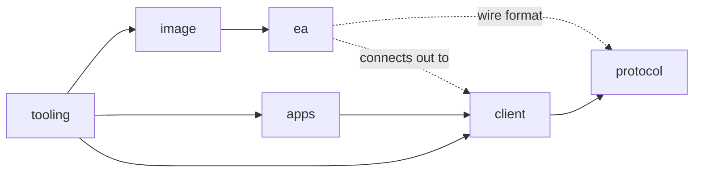

# Overview

| Area | Map | Purpose |
|---|---|---|
| protocol | [protocol.md](protocol.md) | Wire format: framing, flat requests, size limit |
| client | [client.md](client.md) | Go server, Terminal API, types, FakeEA |
| ea | [ea.md](ea.md) | GoBridge EA: connection, dispatcher, tick polling |
| image | [image.md](image.md) | Image build, entrypoint, UI helpers, servers.dat handling |
| apps | [apps.md](apps.md) | Recorder: health poll, symbol retry, -check-live, Myfxbook adapter |
| tooling | [tooling.md](tooling.md) | session.sh, goldrec-e2e.sh stages and reasons, envlint.sh, tests |
