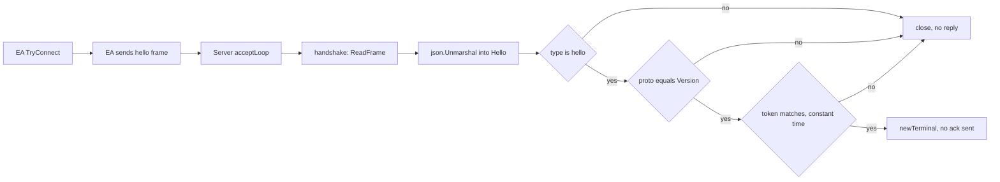
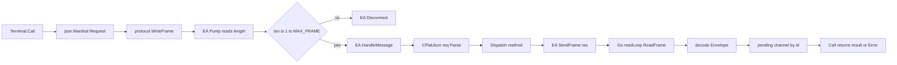
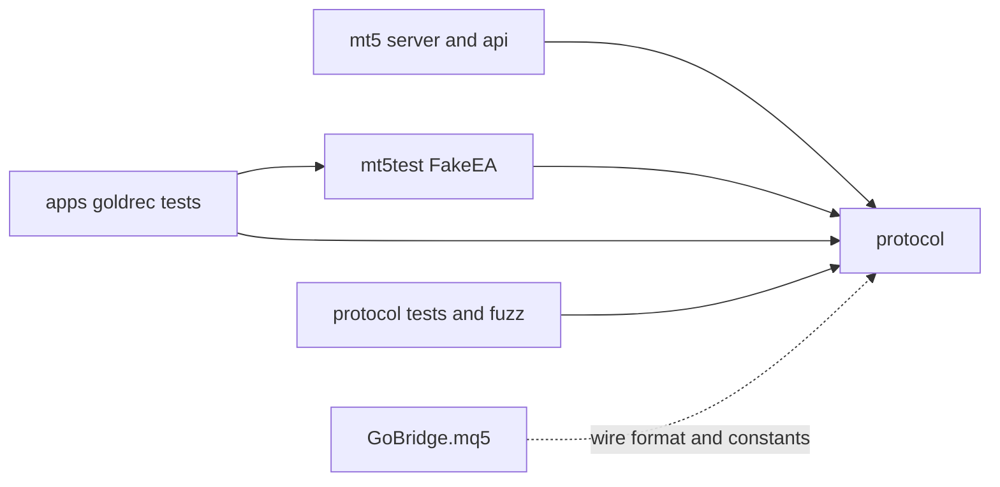

# protocol

## Purpose
Defines the gomql5 bridge wire format between the Go side (`mt5.Server`, `mt5.Terminal`) and the GoBridge EA. Each message is one frame: a 4-byte big-endian length followed by one UTF-8 JSON object. Requests are flat objects of scalar params, and frames are capped at `DefaultMaxFrame` (32 MiB) on both sides.

## Flows

Handshake (EA connects, Go validates the hello):

Request lifecycle (Go call to EA response):

Module dependencies:

## Key symbols

| Symbol | Kind | Path | Grep anchor | Role |
|---|---|---|---|---|
| WriteFrame | Function | protocol/protocol.go | `func WriteFrame(` | Writes one length-prefixed frame; rejects empty payloads |
| ReadFrame | Function | protocol/protocol.go | `func ReadFrame(` | Reads one frame; enforces max size and zero-length check |
| DefaultMaxFrame | Constant | protocol/protocol.go | `const DefaultMaxFrame = 32 << 20` | Default frame cap, 32 MiB |
| Version | Constant | protocol/protocol.go | `const Version = 1` | Protocol version compared in the hello |
| Hello | Type | protocol/protocol.go | `type Hello struct {` | Fields of the first EA frame |
| Request | Type | protocol/protocol.go | `type Request struct {` | Go-to-EA request with scalar params |
| Request.MarshalJSON | Method | protocol/protocol.go | `func (r Request) MarshalJSON()` | Flattens params; rejects reserved names and non-scalar types |
| Envelope | Type | protocol/protocol.go | `type Envelope struct {` | Union decoded from every EA-to-Go message |
| ErrFrameTooLarge | Variable | protocol/protocol.go | `ErrFrameTooLarge = errors.New` | Sentinel for oversize frames |
| ErrEmptyFrame | Variable | protocol/protocol.go | `ErrEmptyFrame = errors.New` | Sentinel for zero-length frames |
| handshake | Method | mt5/server.go | `func (s *Server) handshake(c net.Conn)` | Reads hello; checks type, proto and token |
| Terminal.Call | Method | mt5/server.go | `func (t *Terminal) Call(ctx context.Context` | Marshals a Request, writes it, waits for the response |
| readLoop | Method | mt5/server.go | `func (t *Terminal) readLoop() {` | Reads frames and routes Envelopes |
| MAX_FRAME | Macro | mql5/Experts/GoBridge/GoBridge.mq5 | `#define MAX_FRAME` | EA-side frame cap, same 32 MiB value |
| SendFrame | Function | mql5/Experts/GoBridge/GoBridge.mq5 | `bool SendFrame(const string json)` | EA writes length prefix and body |
| Pump | Function | mql5/Experts/GoBridge/GoBridge.mq5 | `bool Pump()` | EA splits the receive buffer into frames |
| req | Local variable | mql5/Experts/GoBridge/GoBridge.mq5 | `CFlatJson req;` | EA parse of an incoming request in HandleMessage |

## Contract

| Endpoint or message | Server | Client | Payload |
|---|---|---|---|
| hello (EA to Go, first frame) | Go, `mt5.Server` handshake | EA, `TryConnect` | `type`, `proto`, `token`, `ea_version`, `build`, `login`, `server`, `company` |
| request (Go to EA) | EA, `Pump` and `HandleMessage` | Go, `Terminal.Call` | flat object: `id` (uint64), `method` (string), scalar params |
| res (EA to Go) | Go, `readLoop` | EA, `SendFrame` via `SendError` or dispatch | `type`, `id`, `ok`, `result` or `error` {`code`, `message`} |
| event tick (EA to Go, unsolicited) | Go, `handleEvent` | EA, timer and tick sends | `type`, `event`, `data` |

## Dependencies

| Direction | Area | Through |
|---|---|---|
| protocol to client | client | `protocol.ReadFrame`, `protocol.WriteFrame`, `Hello`, `Envelope`, `Request`, `Error` in mt5/server.go and mt5/api.go |
| protocol to client | client | mt5/mt5test/fakeea.go uses `ReadFrame`, `WriteFrame`, `Hello`, `Envelope` |
| protocol to apps | apps | apps/goldrec/record tests use `protocol.Error` and error codes via mt5test |
| protocol to ea | ea | Frame layout, flat request rule, hello fields, and constants `MAX_FRAME` and `PROTO_VERSION` in GoBridge.mq5, plus docs/protocol.md |
| protocol to tooling | tooling | protocol/protocol_test.go and protocol/fuzz_test.go (`FuzzReadFrame`, `FuzzRequestFlat`) |
