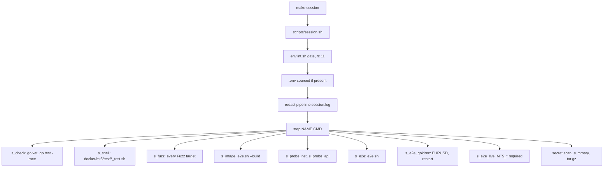
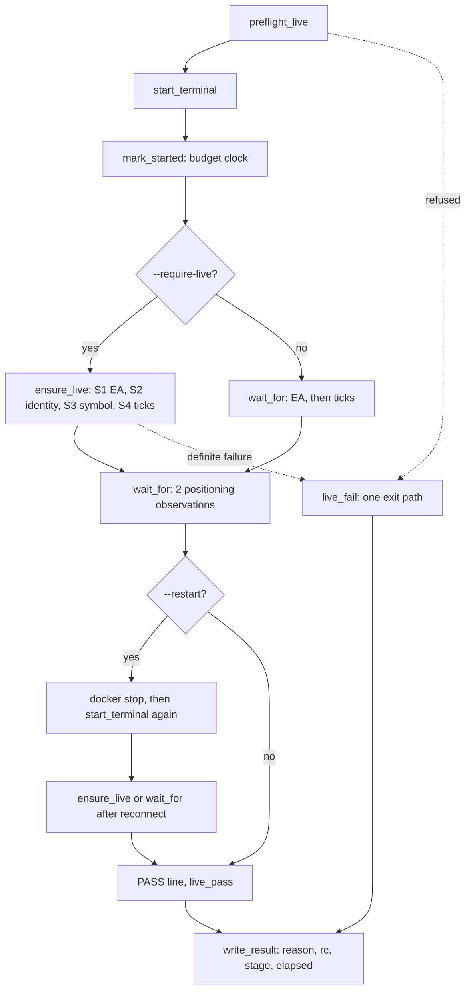
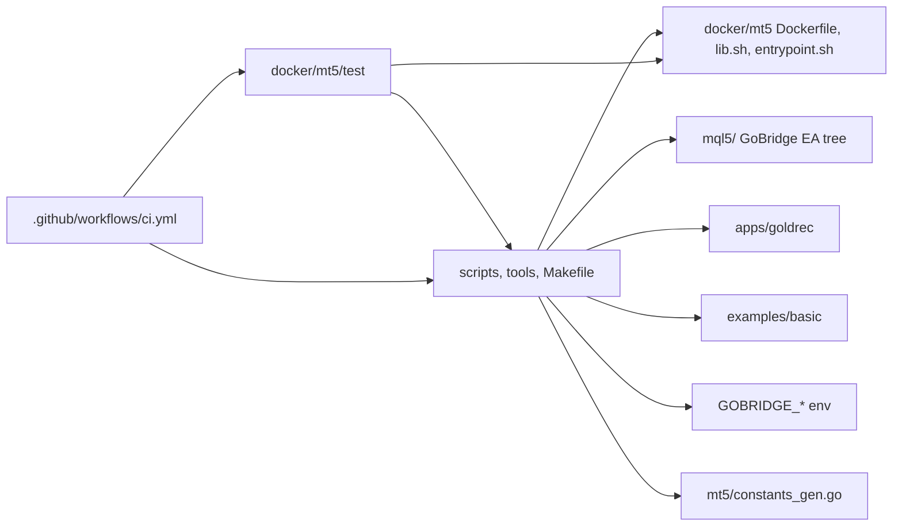

# tooling

## Purpose
- Verification tooling for gomql5: the Makefile and `scripts/session.sh` run every layer into one secret-redacted log and evidence bundle under `session-out/`.
- `scripts/goldrec-e2e.sh` drives the real terminal container with the gold recorder and passes or fails in named stages (preflight, start, restart).
- `scripts/envlint.sh` lints `.env` before anything sources it. `docker/mt5/test/*_test.sh` tests the shell helpers and runs in CI.
- `tools/genconst/genconst.py` regenerates the MT5 constants from the MetaTrader5 package.
- No Go symbols live in this area. gopls was not available in this session, so symbols were located with `git grep`.

## Flows

Call flow: `make session` through `session.sh` steps.

Request lifecycle: one `goldrec-e2e.sh` run.

Module dependencies: what this area touches.

## Key symbols

| Symbol | Kind | Path | Grep anchor | Role |
|---|---|---|---|---|
| step | shell function | scripts/session.sh | `step() { # NAME CMD` | Runs one named step and records PASS, FAIL or SKIP (rc 77 is SKIP) |
| redact | shell function | scripts/session.sh | `redact() {` | Pipes every output line through perl to replace secret values |
| ALL | shell array | scripts/session.sh | `ALL=(env check shell` | Default step order when no step is named |
| s_e2e_live | shell function | scripts/session.sh | `s_e2e_live() {` | Live-account step; refuses with rc 10 when named and MT5_* is missing, otherwise skips |
| s_e2e_goldrec | shell function | scripts/session.sh | `s_e2e_goldrec() {` | No-account recorder run on EURUSD with a restart |
| servers_state_status | shell function | scripts/session.sh | `# servers_state_status DIR:` | Reports the saved servers.dat as verified only when the sha256 marker matches |
| envlint | shell script | scripts/envlint.sh | `envlint: unsafe line` | Rejects any .env line the shell would run; prints the key or position, never the value |
| envlint gate | call site | scripts/session.sh | `bash "$ROOT/scripts/envlint.sh"` | Runs the lint before sourcing .env and exits 11 on failure |
| preflight_live | shell function | scripts/goldrec-e2e.sh | `preflight_live() {` | Checks live prerequisites before the terminal starts and sets EXPECT_SERVER |
| ensure_live | shell function | scripts/goldrec-e2e.sh | `# ensure_live CONNS NEED:` | Live classifier: EA, identity, symbol, then ticks, within the live budget |
| login_failure | shell function | scripts/goldrec-e2e.sh | `# login_failure SERVER (stdin` | Detects a rejected or unknown-server login from the terminal journal |
| goldrec_check | shell function | scripts/goldrec-e2e.sh | `goldrec_check() { "$OUT/goldrec"` | Calls the recorder's `-check-live` verdict on its files |
| promote_state | shell function | scripts/goldrec-e2e.sh | `promote_state() {` | After a live PASS, copies the run's servers.dat to the state dir and writes the marker |
| wait_until | shell function | scripts/goldrec-e2e.sh | `wait_until() {` | Polls a condition to a deadline; a fatal condition ends the run at once |
| mark_started | shell function | scripts/goldrec-e2e.sh | `(mark_started, called by start_terminal)` | Records the container start time that the live budget counts from |
| live_fail | shell function | scripts/goldrec-e2e.sh | `live_fail() {` | Single failure exit: writes result.txt and returns the reason's rc |
| write_result | shell function | scripts/goldrec-e2e.sh | `write_result() {` | Writes result.txt with reason, rc, stage and elapsed |
| GOTMPDIR | Makefile variable | Makefile | `GOTMPDIR := $(shell bash scripts/gotmpdir.sh)` | Picks a Go work dir that is not a noexec /tmp |

## Dependencies

| Direction | Area | Through |
|---|---|---|
| tooling -> image | image | `scripts/e2e.sh` builds `docker/mt5/Dockerfile`; `goldrec-e2e.sh` hashes `docker/mt5/lib.sh` and `entrypoint.sh` against the image |
| tooling -> ea | ea | `goldrec-e2e.sh` hashes the `mql5/` tree and reads the terminal journal and experts log |
| tooling -> apps | apps | `go build ./apps/goldrec`, `goldrec -check-live`, `goldrec -source api -once` |
| tooling -> client | client | `scripts/e2e.sh` builds and runs `examples/basic` against the container |
| tooling -> protocol | protocol | `GOBRIDGE_HOST`, `GOBRIDGE_PORT` and `GOBRIDGE_TOKEN` passed to the container and the recorder |
| image -> tooling | image | `docker/mt5/test/*_test.sh` exercise `docker/mt5/lib.sh` and `entrypoint.sh`; `scripts/mt5ctl.sh` sources the container's `lib.sh` |
