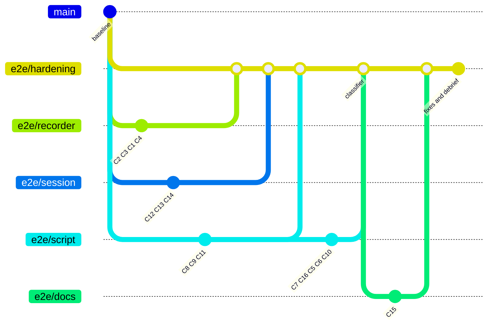

# Status

## Current

| Task | Stage | Mode | Ultracode | Updated |
|---|---|---|---|---|
| Live E2E hardening | Finish: built, reviewed, full gate PASS; not merged into main | AFK | Harness on; phrase not sent | 2026-11-05 |

## Worktrees

| Worktree path | Branch | Task | Stage | Last commit | Next step | Tier |
|---|---|---|---|---|---|---|
| ../gomql5-claude-blissful-pascal-1g9ubj | e2e/hardening | Live E2E hardening | Finish | 8d32004 repo: merge review fixes from e2e/session | User decides: merge into main, and the next item | top |
| ../gomql5-claude-blissful-pascal-1g9ubj-docs | e2e/docs | C15 | Merged | 8458a7c docs: live PASS rules, rc table and corrected live c | Merged | cheap |
| ../gomql5-claude-blissful-pascal-1g9ubj-recorder | e2e/recorder | C1-C4 | Merged | 5621f66 goldrec: -check-live judges the live rules from JSON | Merged | top |
| ../gomql5-claude-blissful-pascal-1g9ubj-script | e2e/script | C5-C11, C16, review fixes | Merged | cf65dd8 goldrec-e2e: follow the container's log so --rm cann | Merged | top |
| ../gomql5-claude-blissful-pascal-1g9ubj-session | e2e/session | C12-C14, review fix 6 | Merged | 7f0a2e1 session: servers status verifies the marker's server | Merged | cheap |

## Tasks

| Number | Task | File or symbol | Check | Tier | State |
|---|---|---|---|---|---|
| C1-C4 | Symbol retry, health poll, server_time, -check-live | `apps/goldrec/record/` | FakeEA tests, injected bugs | top, cheap (C3) | Done |
| C5-C11, C16 | Live classifier, reasons, preflight, state promotion, title | `scripts/goldrec-e2e.sh` | Stub tests, injected bugs, real runs | top, cheap (C7, C10, C11) | Done |
| C12-C14 | No silent skip, .env lint, state status | `scripts/session.sh`, `scripts/envlint.sh`, `Makefile` | Shell tests, injected bugs | cheap | Done |
| C15 | Docs | `README.md`, `docs/*.md` | Login absent from the tree | cheap | Done |
| Review 1-6 | Findings from the squashed review | `scripts/goldrec-e2e.sh`, `scripts/session.sh` | Test failed first, then passes | cheap | Done |
| Open | Myfxbook (no credentials), `examples/basic -trade` (needs the master password) | `docs/ROADMAP.md` | Not run | - | Not started |

## Decisions

| Date | Decision | Reason | By |
|---|---|---|---|
| 2026-11-05 | Route to FTMO-Demo: one manual login in the image | The login saved a working `servers.dat` | User |
| 2026-11-05 | `git init` here, baseline on `main`, work on `e2e/hardening` | No clone was given; nothing runs without git | AFK |
| 2026-11-05 | Login masked before the first commit | Never enters history | AFK |
| 2026-11-05 | D2 = BTCUSD | Exists on FTMO-Demo (E6) and is the Makefile default | AFK |
| 2026-11-05 | D3 = no real login with bad credentials | Lockout policy unknown | AFK |
| 2026-11-05 | Rc 31 fires on any live title without `Read Only` | Section 12 confirmed the title under the read-only password | AFK |
| 2026-11-05 | Terminal-running refusal only for host-network containers | A bridged terminal cannot reach the port on 127.0.0.1 | AFK |
| 2026-11-05 | Host capture: TCP headers of all port 443 traffic on eth0 | Test terminals share the host network; a filter by terminal is impossible | AFK |
| 2026-11-05 | Do not run `make clean-docker` | Prunes the whole host | Agent choice, reported |
| 2026-11-05 | `.env` holds the read-only password only | `scripts/session.sh` asks for it | Agent choice, reported |

## Assumptions

- The proposal's "the plan" is §5 and §8 of `.claude/outputs/live-e2e-proposal.md`.
- The proposed map areas are accepted, because no reply changed them.
- `advanced_start.html` is the user's: left in place and excluded through `.git/info/exclude`.
- `gomql5-vnc` stays on its original image; recording and the user's session take priority over refreshing it.
